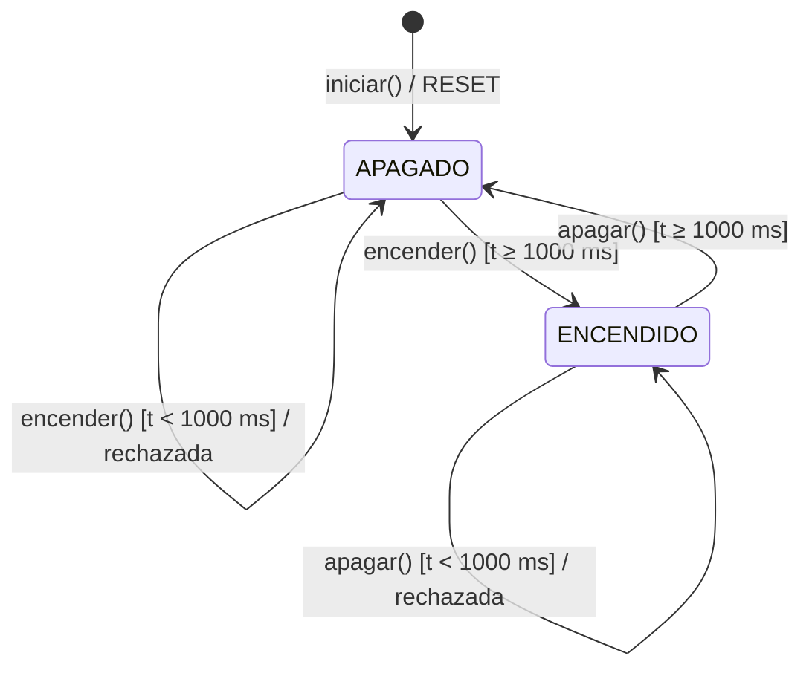
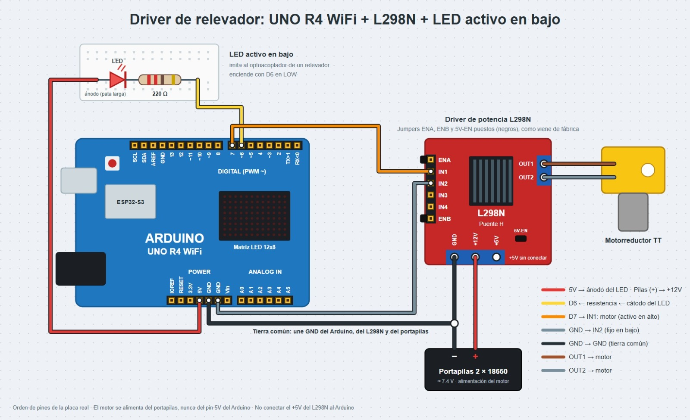

# Driver de software para un relevador

## Descripción

En esta práctica (4.1.1-A) se modeló por software un relevador mediante una clase en C++ llamada `Relevador`, que encapsula su estado, sus órdenes y sus reglas de seguridad, con un Arduino UNO R4 WiFi.

Como no se contaba con un módulo de relevadores, se usaron dos actuadores que lo representan: un canal del puente H L298N con un motorreductor, que funciona como "relevador electrónico" y se activa con nivel alto, y un LED conectado "al revés", que imita al optoacoplador de un módulo real y se activa con nivel bajo. La misma clase controla ambos.

El programa principal nunca escribe directamente en los pines: le da órdenes a la clase (`encender()`, `apagar()`) y ella decide si escribe `HIGH` o `LOW`. La clase también impone un tiempo mínimo de 1 s entre cambios, medido con `millis()`, y garantiza que al encender o reiniciar el sistema todo quede apagado.

## Objetivos

* Abstraer el comportamiento de un relevador en un modelo de software con estados, órdenes y restricciones.
* Aplicar encapsulamiento en C++ para proteger el hardware de órdenes incorrectas.
* Resolver dentro del software la diferencia entre la lógica "activo en alto" y "activo en bajo".
* Separar la parte de señal (Arduino) de la parte de potencia (fuente del motor).
* Impedir conmutaciones demasiado rápidas con una regla de tiempo mínimo basada en `millis()`, sin usar `delay()`.
* Controlar los actuadores con comandos desde el Monitor Serie.

## Herramientas y material utilizado

### Hardware

* Arduino UNO R4 WiFi
* Módulo puente H L298N
* Motorreductor DC (tipo TT, 3–6 V)
* 2 pilas 18650 con portapilas en serie (≈ 7.4 V)
* LED
* Resistencia de 220 Ω
* Protoboard
* Cables jumper macho-macho y macho-hembra
* Cable USB-C

### Software

* Arduino IDE
* Monitor Serie
* Tinkercad

## Diagrama

La parte de potencia (portapilas, L298N y motor) está separada de la parte de señal: el Arduino solo da la orden por D7 y comparte la tierra con el puente H.

| L298N       | Conexión                                     |
| ----------- | -------------------------------------------- |
| +12V        | Positivo del portapilas                      |
| GND         | Negativo del portapilas y GND del Arduino    |
| IN1         | D7                                           |
| IN2         | GND                                          |
| OUT1 y OUT2 | Motorreductor                                |
| ENA         | Con su jumper puesto                         |
| 5V-EN       | Con su jumper puesto                         |

| LED (activo en bajo)  | Conexión                    |
| --------------------- | --------------------------- |
| Ánodo (pata larga)    | 5V del Arduino              |
| Cátodo                | Resistencia de 220 Ω → D6   |

### Diagrama de estados

El relevador tiene dos estados. Arranca en APAGADO y solo cambia de estado si ya pasó el tiempo mínimo desde el último cambio; si no, la orden se rechaza y el pin no se toca.

[Ver carpeta Diagrama](Diagrama)

## Código

La clase `Relevador` guarda en privado el pin, si es activo en bajo, el estado actual, el momento del último cambio y el tiempo mínimo de 1000 ms. Sus métodos públicos son `iniciar()`, que configura el pin y deja el actuador apagado; `encender()` y `apagar()`, que solo actúan si ya pasó el tiempo mínimo y regresan si lo lograron; y `estaEncendido()`, que informa el estado.

El único lugar donde se llama a `digitalWrite()` es el método privado `escribirPin()`, que invierte el nivel cuando el actuador es activo en bajo. Se crean dos objetos de la misma clase: `motor` en D7 (activo en alto) y `led` en D6 (activo en bajo).

En el `loop()` solo se leen los comandos del Monitor Serie, carácter por carácter y sin bloquear:

| Comando   | Acción                          |
| --------- | ------------------------------- |
| `M1` / `M0` | Encender / apagar el motor    |
| `L1` / `L0` | Encender / apagar el LED      |
| `E`       | Mostrar el estado de ambos      |

[Ver código Codigo.ino](Codigo/Codigo.ino)

[Ver carpeta Código](Codigo)

## Pruebas

**Prueba de seguridad 1 (órdenes rápidas):** al enviar `M1` y `M0` lo más rápido posible, la segunda orden responde "Orden rechazada: espere 1 s entre cambios" y el motor se mantiene en su estado.

**Prueba de seguridad 2 (RESET):** con el motor encendido se presionó el botón RESET. Al reiniciar, `iniciar()` deja ambos actuadores apagados y el programa muestra "Sistema iniciado: todo APAGADO (estado seguro)". Como el arranque cuenta como un cambio, hay que esperar 1 s antes de poder volver a encender.

**Prueba de inversión:** si el objeto del LED se crea por error como activo en alto (`Relevador led(6, false);`):

* `iniciar()` escribe `LOW` para "apagar", pero `LOW` enciende el LED, así que **arranca encendido** y se rompe el estado seguro.
* `L1` escribe `HIGH` y el LED se apaga; `L0` escribe `LOW` y se enciende.
* El comando `E` reporta lo contrario de lo que se ve: el modelo de software ya no coincide con el hardware. Con un relevador real, la carga se activaría sola al encender el sistema.

## Resultados

En el Monitor Serie (115200 baudios) cada orden responde con un mensaje, por ejemplo "Motor ENCENDIDO", "LED APAGADO" u "Orden rechazada: espere 1 s entre cambios", y el comando `E` muestra el estado de ambos actuadores.

[Ver carpeta Resultados](Resultados)

## Video

En el siguiente video se muestra el control del motor y del LED desde el Monitor Serie y las pruebas de seguridad.

[Ver video de la práctica](https://youtube.com/shorts/0-JmM2MyYfA)

[Ver carpeta Video](Video)

## Preguntas de reflexión

**1. ¿Por qué el LED se enciende con LOW y no con HIGH? Explica el recorrido de la corriente.**

El ánodo está fijo a 5 V y el cátodo va, a través de la resistencia, al pin D6. Con D6 en `LOW` (0 V) hay una diferencia de unos 5 V: la corriente sale del pin de 5 V, atraviesa el LED y la resistencia, y entra al pin D6, que la "hunde" hacia GND dentro del microcontrolador. Con D6 en `HIGH` ambos extremos quedan a 5 V, no hay diferencia de potencial y no circula corriente. Así funciona el LED del optoacoplador en los módulos de relevador comerciales.

**2. ¿Qué ventaja tiene que la regla del tiempo mínimo viva dentro de la clase y no en el `loop()`?**

Nadie puede saltársela: cualquier parte del programa que mande una orden pasa forzosamente por la regla. Cada objeto lleva su propio temporizador, el `loop()` queda limpio y la clase se puede reutilizar en otros proyectos con la protección incluida. Si la regla estuviera en el `loop()`, habría que repetirla en cada lugar que conmuta y bastaría un olvido para dañar el relevador.

**3. ¿Por qué un relevador real no sirve para controlar velocidad con PWM?**

Porque es mecánico: sus contactos tardan varios milisegundos en moverse y rebotan, mientras que una señal PWM conmuta cientos o miles de veces por segundo. El relevador no alcanzaría a seguir la señal, y cada conmutación produce arco eléctrico y desgaste; su vida útil se mide en cientos de miles de operaciones, que con PWM se agotarían en minutos. Para PWM se usan interruptores electrónicos como transistores, MOSFET o el puente H.

**4. ¿Por qué el estado seguro es "apagado"? Da un ejemplo industrial donde convenga lo contrario (contacto NC).**

Si el sistema falla, se reinicia o pierde energía, lo más seguro suele ser que nada se mueva ni se caliente: un motor que arranca solo puede lastimar a alguien o dañar la máquina. Conviene lo contrario cuando una función debe seguir activa ante una falla, por ejemplo una bomba de enfriamiento o un extractor de gases en una zona con riesgo de acumulación: se conectan al contacto NC para que, si el control se cae, sigan funcionando.

**5. ¿Por qué es obligatoria la tierra común entre el portapilas y el Arduino?**

Porque un voltaje siempre se mide respecto a una referencia. El L298N interpreta la señal de IN1 comparándola con su propio GND; si ese GND no está unido al del Arduino, el `HIGH` de D7 no tiene referencia ni camino de retorno, el nivel queda indefinido y el motor puede no responder o comportarse de forma errática.

**6. Si mañana cambiaras el L298N por un módulo de relevador real, ¿qué partes del programa tendrías que modificar?**

Solo la creación del objeto: el pin y, normalmente, el parámetro de activo en bajo, porque la mayoría de los módulos con optoacoplador se activan con `LOW` (y quizá el tiempo mínimo, según la hoja de datos del relevador). La clase y el `loop()` no cambian; esa es la ventaja de encapsular el dispositivo. En el hardware sí cambia el cableado: VCC, GND y la entrada IN del módulo.

## Conclusiones

La práctica permitió comprender que un actuador no debe controlarse con pines sueltos repartidos por el programa, sino con un modelo de software que recuerde su estado y le hable al resto del código con órdenes que tienen significado, como encender y apagar.

También se comprobó que la diferencia entre "activo en alto" y "activo en bajo" se puede resolver por completo dentro de la clase: el mismo código controla el motor y el LED, y un error en ese parámetro se traduce en que el sistema arranque con la carga encendida.

Finalmente, la regla del tiempo mínimo y el estado inicial apagado mostraron que las restricciones físicas y de seguridad deben vivir dentro del modelo del dispositivo, para que ninguna parte del programa pueda saltárselas.
